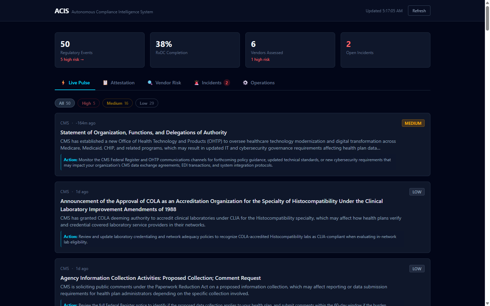
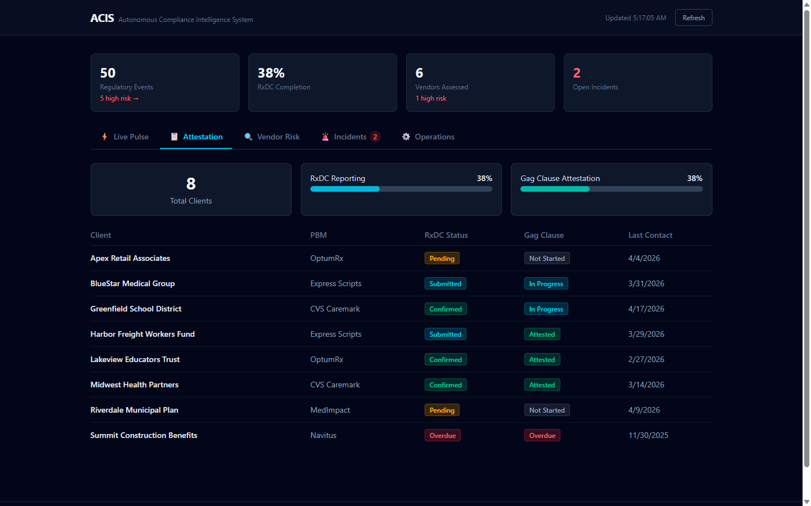
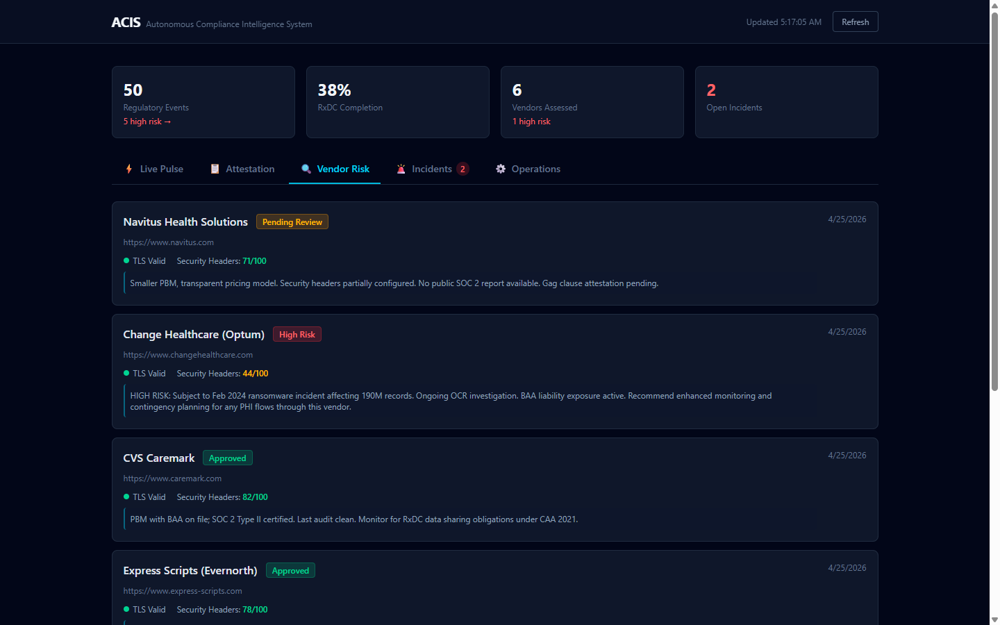
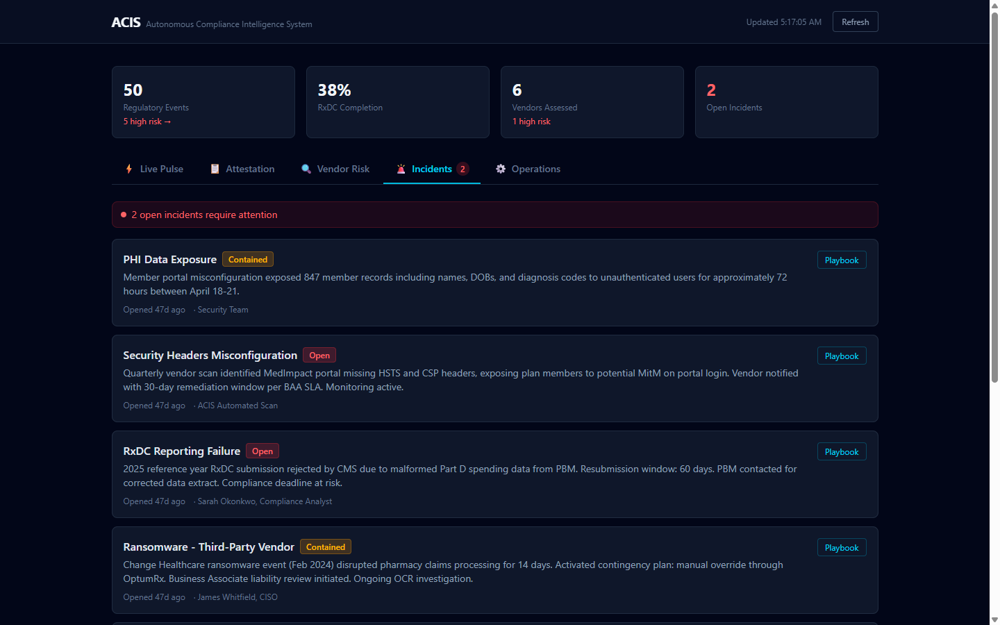
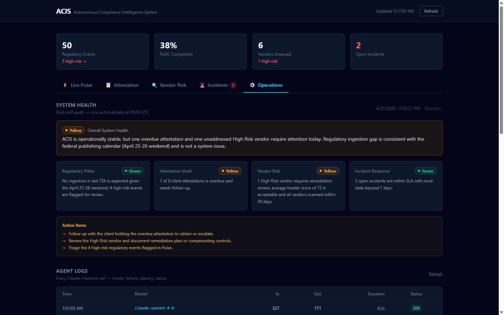

# ACIS — Autonomous Compliance Intelligence System

**Live at [acis.rossonlineservices.com](https://acis.rossonlineservices.com)**

A HIPAA compliance operations platform built and operated solo. Four compliance modules, six AI agents, serverless edge infrastructure — designed, built, and running in production.

---

## What It Does

ACIS automates the operational overhead of healthcare compliance: regulatory monitoring, attestation lifecycle tracking, vendor risk assessment, and incident response — with AI agents handling the analytical heavy lifting at each layer.

| Module | What It Automates |
|---|---|
| **Regulatory Pulse** | Daily ingestion of CMS, HHS, and Federal Register sources; Claude scores each document for HIPAA risk, impacted fields, and remediation steps |
| **Attestation Vault** | RxDC and Gag Clause lifecycle tracking across client plans; automated overdue alerts via email |
| **Vendor Risk** | Live TLS + security-header scoring per vendor; Claude generates HIPAA Business Associate risk narratives |
| **Incident Response** | NIST SP 800-61 Rev 2 playbooks auto-generated on incident creation; HIPAA reportability determination with OCR deadlines and CFR citations |

---

## AI Agents in Production

Four Claude agents — each scoped to a task-appropriate model, with bounded token budgets, structured output parsing, and idempotent cron logic:

| Agent | Model | Trigger | Output |
|---|---|---|---|
| Regulatory scraper | claude-sonnet-4-6 | Daily 08:00 UTC cron | Structured risk events: `risk_level`, `impacted_field`, `remediation_step`, `deadline` |
| Heartbeat agent | claude-opus-4-8 | Daily cron | Green/Yellow/Red system health report; 13-metric D1 batch |
| Playbook generator | claude-opus-4-8 | On incident creation | Full NIST 800-61 playbook with HIPAA reportability + CFR citations |
| Vendor scanner | claude-opus-4-8 | On-demand | TLS + header scores + HIPAA BAA risk narrative |

Every inference call routes through a Cloudflare AI Gateway — logs model, latency, token counts, and HTTP status without capturing payload content.

High-risk regulatory findings (score ≥ 8) automatically open GitHub pull requests for remediation tracking. The 6 open PRs in this repo are live examples.

---

## Stack

| Layer | Technology |
|---|---|
| Compute | Cloudflare Workers (TypeScript) |
| Database | Cloudflare D1 (edge SQLite) |
| File storage | Cloudflare R2 |
| Frontend | React + Tailwind, deployed on Cloudflare Pages |
| AI inference | Anthropic Claude via Cloudflare AI Gateway |
| Scraping | Firecrawl API (bypasses CMS/HHS bot protection) |
| Regulatory data | Federal Register API, Regulations.gov API |
| Email | Resend API (attestation + incident alerts) |
| Version control | GitHub with automated compliance-alert PR workflow |

---

## HIPAA Boundary Design

- Inference logging without content exposure — AI Gateway logs metadata only; prompt/response bodies never land in observability tooling
- Parameterized D1 queries throughout — no string interpolation at the query layer
- Attestation documents in R2 vault, isolated from application state
- Worker error responses return structured JSON; stack traces and record contents are never surfaced to clients or logs
- Audit events capture actor, action, and timestamp — without duplicating record content into the audit stream

---

## Screenshots

**Live Pulse — Regulatory monitoring with AI risk scoring**

**Attestation Vault — RxDC + Gag Clause lifecycle tracking**

**Vendor Risk — Live TLS scoring + AI HIPAA narratives**

**Incident Response — NIST 800-61 playbooks auto-generated**

**Operations — AI Gateway agent logs: model, tokens, latency, status**

---

## Built By

Solo-built by [ross0nline](https://github.com/ross0nline) with [AIBuddy](https://github.com/apps/claude) as co-author on all commits.
