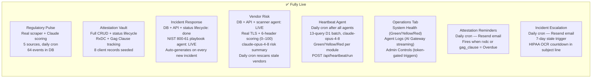

---
created_session: post-78e6e2b4-compaction-4
sweep_count: 3
touches:
  - { session: post-78e6e2b4-compaction-4, action: swept, model: claude-sonnet-4-6 }
  - { session: post-78e6e2b4-compaction-4, action: updated, model: claude-sonnet-4-6 }
  - { session: post-78e6e2b4-compaction-6, action: updated, model: claude-sonnet-4-6 }
---
# 008 — Current Build State & Remaining Roadmap

**Date:** 2026-04-25 (updated 2026-04-26 — portfolio viewer live, ADRs 016–017 written, IMPACT.md + CHECKLIST.md added)  
**Status:** Reference — updated as phases complete

---

## What Is Actually Built vs. Pending



---

## Regulatory Pulse — Complete

- Cron scraper runs daily at 08:00 UTC
- Five source pipelines: Federal Register (CMS, EBSA, HHS), Regulations.gov (CMS, HHS, EBSA, OCR), Firecrawl (CMS Newsroom, HHS Press Room)
- Claude scores every document: risk level, impacted field, summary, remediation step, deadline
- Deduplication by URL — idempotent runs
- Open comment periods enforce minimum Medium (5) risk score
- Manual trigger: `POST /api/scraper/run` (admin auth)

## Attestation Vault — Complete

- Full CRUD for client plan records
- Two compliance dimensions tracked per client: `rxdc_status`, `gag_clause_status`
- `GET /api/attestation` returns completion percentages
- R2 folder path stored per record for future document upload integration

## Incident Response — Complete (see ADR 009)

- Full CRUD + status lifecycle (Open → Contained → Remediated → Closed)
- `POST /api/incidents` auto-generates a NIST 800-61 playbook via Claude before returning
- `POST /api/incidents/:id/playbook` regenerates playbook on demand
- Playbook structure: severity, HIPAA reportability, 60-day OCR deadline, 5 NIST phases, CFR citations, escalation contacts
- Executive Hub renders full `PlaybookView` with semantic color-coding per phase

## Vendor Risk — Complete (see ADR 010)

- `POST /api/vendors/scan-all` — scans all 6 vendors in parallel (admin auth)
- `POST /api/vendors/:id/scan` — on-demand single-vendor scan (admin auth)
- **Daily cron:** `runVendorScan(env)` queries `getStaleVendors()` — vendors where `scanned_at IS NULL OR scanned_at < datetime('now', '-30 days')`
- Scanner: HEAD-fetches vendor URL with 10s timeout, inspects 6 security headers, computes 0–100 `headers_score`
- Headers scored: HSTS (20), CSP (20), X-Frame-Options (15), X-Content-Type-Options (15), Referrer-Policy (15), Permissions-Policy (15)
- `claude-opus-4-8` produces HIPAA-framed `ai_risk_summary` and `overall_status` (Approved / Requires Review / High Risk / Pending Review)
- `updateVendorScan()` writes computed results + refreshes `scanned_at`

## Email Agents — Complete

**Attestation Reminders** (`src/agents/attestation-reminder.ts`)
- Fires daily when any record has `rxdc_status = 'Overdue'` OR `gag_clause_status = 'Overdue'`
- Sends HTML table of affected clients to `rossonlineservices@gmail.com` via Resend
- No-op on clean days — no spam

**Incident Escalation** (`src/agents/incident-escalation.ts`)
- Fires daily when any incident has `status = 'Open' AND opened_at < datetime('now', '-7 days')`
- Email includes days-open count and HIPAA OCR window countdown per incident
- Subject line escalates to `⚠️ URGENT` when any incident hits 45+ days
- Cites 45 CFR § 164.404 (60-day Breach Notification Rule)

**Email service** (`src/services/email.ts`) — Resend raw fetch abstraction; `from: acis@rossonlineservices.com`; domain verified for sending.

## Daily Cron Sequence (08:00 UTC)

```
runScraper → runVendorScan → runAttestationReminders → runIncidentEscalation → runHeartbeat
```

---

## Seeded Demo Data (current)

| Module | Records | Notes |
|---|---|---|
| Regulatory Events | 64 | Real federal data, Claude-scored, 5 sources |
| Attestation | 8 clients | Realistic mix of statuses |
| Vendor Risk | 6 vendors | Change Healthcare correctly flagged High Risk |
| Incidents | 7 incidents | Full status range + AI playbooks on new records |

---

## Portfolio Viewer — Complete (see ADR 017)

- Live at `portfolio.rossonlineservices.com`
- Separate Cloudflare Worker (`portfolio/`) — independent from ACIS, no shared DB
- Fetches Markdown from `raw.githubusercontent.com` at request time (no build step, no rate limits)
- `marked` v15 renders to HTML; Mermaid diagrams auto-initialize via CDN
- KV-backed document visibility toggles — admin sets per-doc visibility via `/admin?token=...`
- Dark/light mode with CSS custom properties (no flash — inline `<head>` script)
- Per-document accent colors; prev/next navigation by doc index
- No social media plugins (privacy-first design)
- PWA support pending: manifest.json + icon.svg + service worker routes (see `CHECKLIST.md`)
- `portfolio-deploy` script enforces push-before-deploy (content fetched from GitHub at runtime)

---

## MCP Server — Built (2026-06-12, #482)

**ACIS MCP server** (`src/mcp.ts`) — exposes all four compliance modules as named tools at `/mcp`:

| Tool | Description |
|---|---|
| `list_regulatory_events` | D1 regulatory events with optional risk_level filter (high/medium/low/all) and limit |
| `list_incidents` | D1 incidents with optional status filter; urgency-sorted (Open first) |
| `list_vendors` | D1 vendor risk records with optional status filter |
| `list_attestations` | D1 attestation records with optional overdue_only flag |
| `get_system_status` | Batch counts across all four modules in a single call |
| `get_heartbeat_report` | Latest Heartbeat Agent audit from agent_memory |

- Stateless pattern (`createMcpHandler`) — no Durable Object migration required
- Auth: `Authorization: Bearer <ADMIN_TOKEN>` checked in fetch handler before MCP delegation
- MCP client config: `mcp-remote https://acis.rossonlineservices.com/mcp --header "Authorization: Bearer TOKEN"`
- `wrangler.toml` unchanged — `nodejs_compat` flag already present, no new bindings required

**Incidents PATCH endpoint** (`src/modules/incidents.ts`)
- `PATCH /api/incidents/:id` — update description and/or reporter fields after incident creation
- Complements existing `PATCH /api/incidents/:id/status` for status-only changes

## Remaining Build Queue

1. **CCC Admin `/api/status` endpoint** — ACIS exposes structural state; CCC Admin polls it for dynamic build tracking
2. **Admin subdomain data explorer** — `admin.rossonlineservices.com`; AppSheets-style table CRUD for D1 modules (regulatory_events, attestation, vendors, incidents); first feature of the private admin panel

## Code Quality Improvements (2026-06-12)

**Model constants centralization** (`src/config/models.ts`)
- `OPUS_MODEL = 'claude-opus-4-8'` and `SONNET_MODEL = 'claude-sonnet-4-6'` exported from one file
- All 4 agents (vendor-scanner, heartbeat, playbook, scraper) import from constants — future model upgrades are a one-file change

**Vendor scanner deterministic status** (`src/agents/vendor-scanner.ts`)
- `computeOverallStatus()` replaces Claude-generated `overall_status` — logic is deterministic TypeScript
- Claude now only generates `ai_risk_summary`; status classification never depends on LLM variance
- Rules: `tls_valid=0 && score=0 → Pending Review` | `tls_valid=0 → High Risk` | `score≥70 → Approved` | `score≥40 → Requires Review`

**Scraper structured error logging** (`src/agents/scraper.ts`)
- 7 silent `catch {}` blocks replaced with `console.error`/`console.warn` calls
- Claude failures (parse, score) log at `error` level; network failures log at `warn` with source context
- URL probe failures (isUrlLive, verifyUrlContent) remain silent with explanatory comments — expected behavior

**Executive Hub UI enhancements** (`frontend/src/`)
- All 4 stat cards are now clickable navigation shortcuts (pulse → high-risk filter, attestation, vendors, incidents)
- Regulatory event cards surface `tags` (RxDC, HIPAA, etc.) as cyan badge and `deadline` in amber when present
- Admin Controls trigger grid fixed to responsive 2-col/4-col layout; model name corrected to `claude-opus-4-8`
- VendorBoard: dead JSON.parse on `ai_risk_summary` removed (field is stored as plain string)

---

## GitHub PR Automation — Complete (2026-04-27)

- `src/services/github.ts` — `createCompliancePR(env, event, scored)` fires after any new ingestion with `risk_score ≥ 8`
- Branch naming: `compliance/alert-{date}-{event_id}` — idempotent (422 = already exists, skips)
- Alert file written to `docs/compliance-alerts/{date}-{slug}.md` in `ross0nline/acis`
- PR body: event title, source, risk score, HIPAA impact area, Claude summary, required action, source URL
- `GITHUB_TOKEN` Worker secret set — fine-grained PAT, Contents + PRs R/W on `ross0nline/acis`
- `POST /api/scraper/demo-pr` — admin endpoint to trigger PR for highest-risk existing D1 event
- Demo PR #1 open: ACA HHS Notice of Benefit and Payment Parameters for 2027 (Risk: 9/10)
